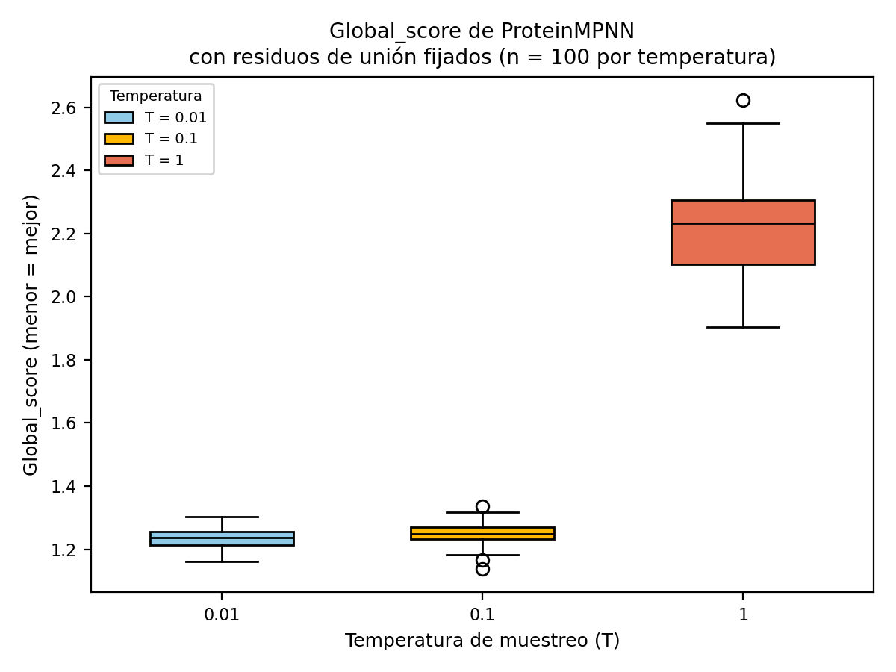
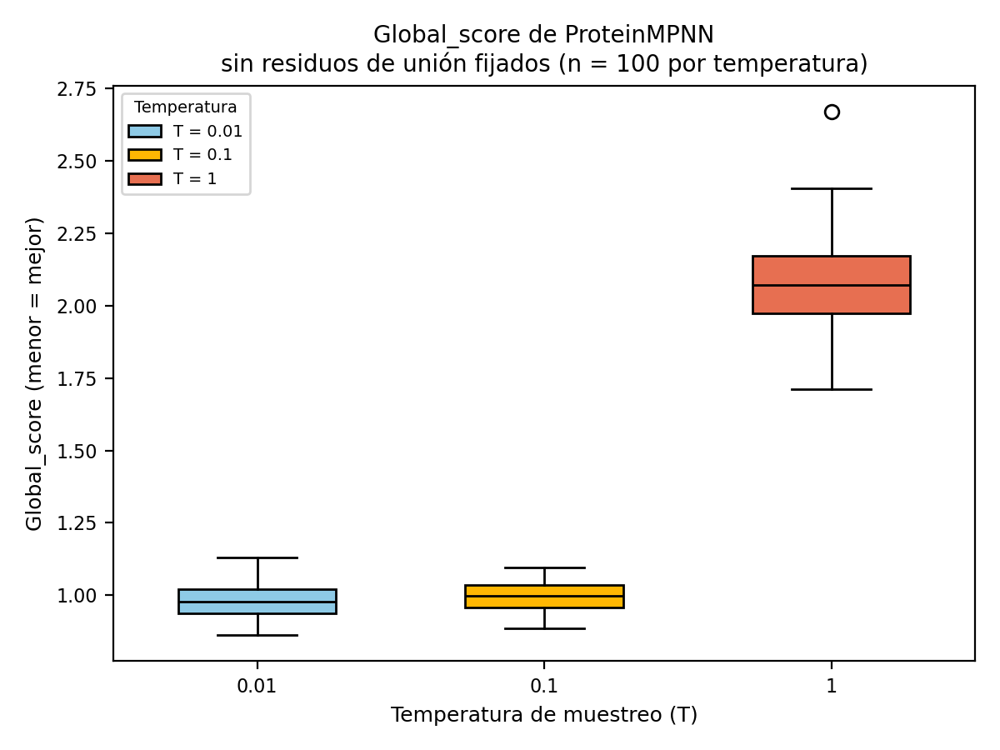

# Structural Bioinformatics: Isomerases and Binder #223

**Computational analysis of LLM-generated protein sequences, ProteinMPNN sequence design, and AlphaFold3 structural evaluation**

**Course:** Structural Biology Sessions 5 and 6  
**Instructor:** Sergio Romero Romero  
**Team:** Rubí, Mónica, and Natalie  
**Date:** November 2026

---

## Project Overview

This project investigates two applications of computational protein modeling:

1. **LLM-generated isomerases:** Analysis of protein sequences generated by a language model, selection according to perplexity, and comparison with natural protein sequences.
2. **Patulin binder #223:** Sequence design with ProteinMPNN under different sampling temperatures and residue-fixation conditions.

Selected sequences are subsequently evaluated using AlphaFold3 to examine structural confidence and, where appropriate, structural similarity.

The results represent computational predictions and do not constitute experimental validation of protein folding, enzymatic activity, or ligand binding.

## 1. LLM-Generated Isomerases

### Sequence selection

A dataset of 1,000 LLM-generated sequences was analyzed using perplexity.

Five sequences with the lowest perplexity and five with the highest perplexity were selected.

| Group | Identifier | Length (aa) | Perplexity |
|---|---|---:|---:|
| Low | seq_240_low_3 | 210 | 1.06 |
| Low | seq_287_low_3 | 452 | 1.07 |
| Low | seq_1381_low_3 | 204 | 1.07 |
| Low | seq_2_low_3 | 199 | 1.07 |
| Low | seq_503_low_3 | 222 | 1.07 |
| High | seq_1543_high_3 | 285 | 7.84 |
| High | seq_1358_high_3 | 495 | 7.93 |
| High | seq_1095_high_3 | 334 | 8.09 |
| High | seq_311_high_3 | 433 | 8.17 |
| High | seq_2122_high_3 | 490 | 9.84 |

Perplexity characterizes the sequences under the generating model. Lower perplexity does not necessarily imply higher structural confidence or biological functionality.

### Natural sequence comparison

The sequence-length distribution of the 1,000 generated proteins was compared with 1,000 natural protein sequences sampled from a UniProt dataset retrieved using EC 5.3.1.24.

### Outputs

- `entregables/isomerasas_10_secuencias.csv`
- `entregables/isomerasas_10_af3.fasta`
- `entregables/naturales_1000.fasta`
- `entregables/longitudes.png`

The sequence-selection and length-analysis scripts are available as `parte1.py` and `longitudes.py`.

---

## 2. ProteinMPNN: Patulin Binder #223

### Structural input and design strategy

ProteinMPNN was used to generate amino acid sequences compatible with a binder backbone previously generated using RFdiffusion.

Two design strategies were investigated:

- **Fixed residues:** The identities of seven proposed patulin-interaction residues were preserved.
- **Unfixed residues:** All positions were available for sequence redesign.

Three sampling temperatures were examined: 0.01, 0.1, and 1.0.

Each condition generated 100 sequences, producing 600 designs across six FASTA files.

### Fixed interaction residues

| Position | Amino acid |
|---|---|
| 12 | Leucine (L) |
| 20 | Serine (S) |
| 50 | Valine (V) |
| 52 | Lysine (K) |
| 68 | Phenylalanine (F) |
| 73 | Phenylalanine (F) |
| 74 | Phenylalanine (F) |

The seven specified residues were verified in all 100 sequences from each fixed-residue condition.

### Sequence selection

For each FASTA file, the three sequences with the lowest and three with the highest `global_score` were selected.

The resulting dataset includes **36 sequences**.

File: `entregables/binder223_36_secuencias.csv`

### Global score distribution

The distributions of `global_score` were compared across the three sampling temperatures.

**Fixed residues**



**Unfixed residues**



### Preliminary results

Median `global_score`:

| Design condition | T = 0.01 | T = 0.1 | T = 1.0 |
|---|---:|---:|---:|
| Fixed residues | 1.237 | 1.249 | 2.232 |
| Unfixed residues | 0.98 | 1.00 | 2.07 |

Mean pairwise sequence identity:

| Design condition | T = 0.01 | T = 0.1 | T = 1.0 |
|---|---:|---:|---:|
| Fixed residues | 72.1% | 69.8% | 25.5% |
| Unfixed residues | 66.9% | 63.6% | 20.2% |

Increasing the sampling temperature from 0.1 to 1.0 was associated with substantially greater sequence diversity and higher, less favorable `global_score` values.

At low temperatures, unfixed-residue designs displayed lower median scores than fixed-residue designs. However, removing residue constraints also permitted changes at positions associated with the proposed ligand-binding interface.

ProteinMPNN evaluates sequence compatibility with the supplied backbone. Its scores do not directly measure binding affinity or functional activity.

These results represent trends observed using a single backbone and one sampling seed per condition.

---

## 3. AlphaFold3 Structural Evaluation

Selected sequences are undergoing structural prediction using AlphaFold3.

The evaluation includes:

- **Mean pLDDT:** Predicted local structural confidence.
- **pTM:** Predicted confidence in the global topology.
- **Mean PAE:** Average predicted aligned error.
- **RMSD:** Structural deviation following alignment to an appropriate reference, where available.

### Preliminary isomerase result

The first analyzed sequence was `seq_240_low_3`, with 210 amino acids and a perplexity of 1.06.

AlphaFold3 model 0 produced:

| Metric | Value |
|---|---:|
| Mean atom pLDDT | 91.781 |
| pTM | 0.93 |
| Mean PAE | 2.819 Å |

The pLDDT value was calculated from the atom-level confidence array. Protein-chain filtering against the structural model remains to be verified before final reporting.

These confidence metrics describe the prediction and should not be interpreted as experimental confirmation of structure, stability, or enzymatic function.

### Ongoing analysis

The complete comparison will incorporate the ten selected isomerases and the 36 ProteinMPNN binder designs.

For binder structural comparisons, the protein chain of the original binder will be used as the reference, excluding the ligand from protein backbone alignment.

---

## 4. Repository Organization

```text
.
├── README.md
├── .gitignore
├── binder_patulin_223.pdb
├── binder_223_fijos.pdb
├── fixed_residues_binder_223.txt
├── parte1.py
├── longitudes.py
└── entregables/
    ├── isomerasas_10_secuencias.csv
    ├── isomerasas_10_af3.fasta
    ├── naturales_1000.fasta
    ├── longitudes.png
    ├── binder223_36_secuencias.csv
    ├── binder223_fijados_T0.01.fasta
    ├── binder223_fijados_T0.1.fasta
    ├── binder223_fijados_T1.fasta
    ├── binder223_libres_T0.01.fasta
    ├── binder223_libres_T0.1.fasta
    ├── binder223_libres_T1.fasta
    ├── boxplot_fijados.png
    └── boxplot_libres.png
```

Complete AlphaFold3 output directories and the external ProteinMPNN codebase are excluded from Git tracking.

## 5. References and Resources

1. Dauparas et al. (2022). *Robust deep learning-based protein sequence design using ProteinMPNN.* Science. https://doi.org/10.1126/science.add2187
2. ProteinMPNN repository: https://github.com/dauparas/ProteinMPNN
3. UniProt: https://www.uniprot.org/
4. AlphaFold Server: https://alphafoldserver.com/

## Project Status

**Completed:** Sequence selection, sequence-length comparison, ProteinMPNN generation, residue verification, score analysis, and preliminary interpretation.

**In progress:** AlphaFold3 predictions, confidence-metric extraction, structural alignment, RMSD analysis, and final comparison.

